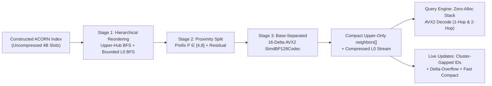
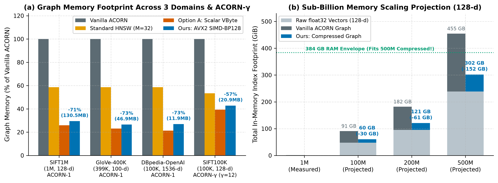
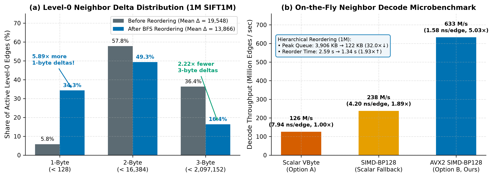
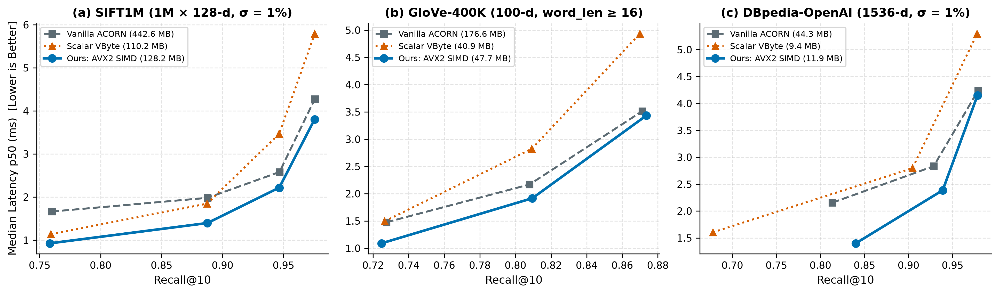
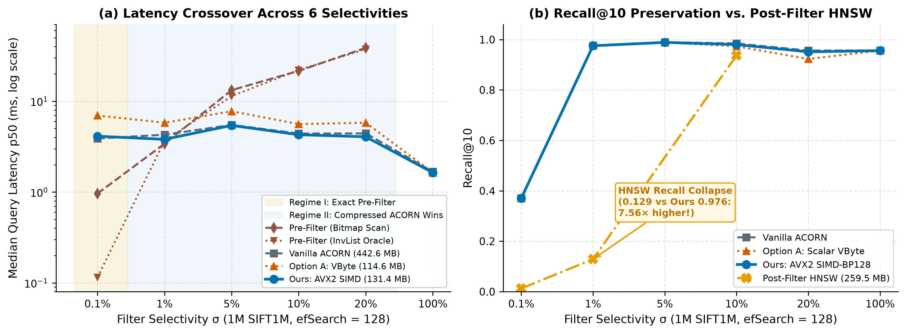
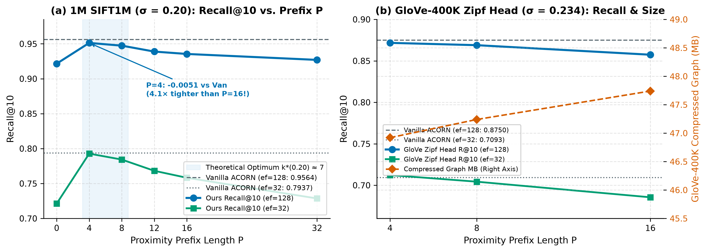
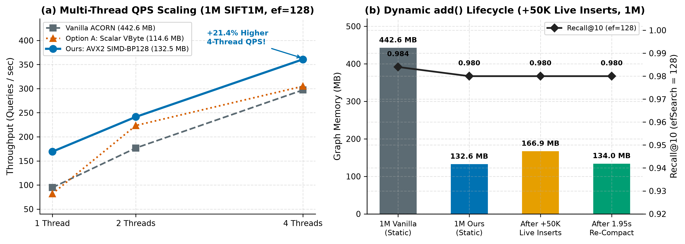

# Scalable and Memory-Efficient Hybrid Vector Search: Hierarchical Graph Reordering and Proximity-Preserving SIMD Delta Compression for ACORN

**Author:** Muhammad Borhan  
**Target Venue:** *Information Systems* (Elsevier, SCI Q1) / *Future Generation Computer Systems* (SCI Q1) / *IEEE Transactions on Knowledge and Data Engineering (TKDE)*

---

## Abstract

Hybrid vector search—evaluating approximate nearest neighbor (ANN) queries over high-dimensional embeddings jointly with arbitrary structured metadata predicates—is a core primitive in retrieval-augmented generation (RAG) and enterprise search systems. The ACORN index (Patel et al., SIGMOD 2024) supports predicate-agnostic filtering on a single hierarchical graph via dynamic two-hop neighborhood expansion, but its dense Level-0 adjacency layout imposes a substantial memory footprint: storing $112$–$125$ fixed 32-bit integer slots per vertex consumes nearly as much, or more, DRAM than the raw embeddings themselves (442.6 MiB vs. 488.3 MiB on SIFT1M; 176.6 MiB vs. 152.2 MiB on GloVe-400K). While graph reordering and integer delta compression are well-known building blocks in information retrieval and graph processing, applying them directly to ACORN exposes three domain-specific failure modes: (i) scalar variable-byte (VByte) decoding incurs 25%–79% latency overhead under two-hop expansion amplification, (ii) monolithic 128-integer SIMD bit-packing wastes space on short adjacency lists ($\bar{d}_0 \approx 50$) and suffers bit-width inflation from large initial vertex IDs, and (iii) sorting full adjacency lists disrupts ACORN's distance-ordered early-termination rule at moderate-to-high filter selectivities.

We address these three bottlenecks through a compressed storage and execution layout integrated into ACORN. First, we introduce a hierarchical multi-layer graph reordering procedure that leverages ACORN's upper-layer hubs to localize Level-0 IDs in $O(N\bar{d}_0)$ time while bounding transient queue memory to $O(N/M + B_{\text{loc}})$, reducing peak queue workspace by $32.0\times$ and reordering time by $1.93\times$ relative to flat BFS. Second, we design a base-separated 16-delta mini-block AVX2 bit-packing codec (`SimdBP128Codec`) that decodes into stack memory at 1.58 ns/edge ($5.02\times$ faster than scalar VByte). Third, we analyze ACORN's two-hop `2M` stopping rule to derive an expected outer-loop horizon $k^*(\sigma) = \min(\bar{d}_0, \lceil 2M / (\sigma(1+\bar{d}_0)) \rceil)$, motivating a compact proximity-preserving prefix split ($P \in [4, 8]$) that reduces high-selectivity recall degradation by $4.1\times$–$5.3\times$. Fourth, we support live vector insertions via cluster-gapped ID allocation and a delta-overflow buffer (1,897.8 inserts/s on 1M vectors) with 1.95 s batch re-compaction. Across SIFT1M (1M $\times$ 128-d), GloVe-400K (399K $\times$ 100-d under real range, compound, and Zipfian predicates), and DBpedia-OpenAI (100K $\times$ 1,536-d), our layout reduces ACORN graph memory by 70.5%–73.4% (57.2% on dense ACORN-$\gamma$)—49.7%–54.7% smaller than uncompressed HNSW—while matching or reducing median query latency by 2.0%–46.7% across $\sigma \in [1\%, 100\%]$ (with a +6.0% overhead at $\sigma = 0.1\%$, where exact pre-filtering dominates) and improving 4-thread throughput by 21.4% on a single-node workstation.

**Keywords:** Hybrid Vector Search; Filtered Approximate Nearest Neighbor (ANN); Proximity Graph Compression; Graph Reordering; AVX2 SIMD Bit-Packing; ACORN; HNSW.

---

## 1. Introduction

Vector retrieval engines increasingly serve *hybrid queries* that combine approximate nearest neighbor (ANN) similarity search over dense embeddings with arbitrary structured metadata predicates, including access-control filters, numerical or lexical ranges, and skewed categorical attributes:
$$\arg\min_{u \in V,\, \mathcal{P}(u) = 1} \text{dist}(q, x_u),$$
where $q \in \mathbb{R}^d$ is the query vector and $\mathcal{P}: V \to \{0, 1\}$ is an ad-hoc predicate evaluated at query time.

Existing filtered-ANN strategies exhibit a persistent trade-off between predicate generality, query efficiency, and memory footprint:

1. **Pre-Filtering and Post-Filtering:** Exact *pre-filtering* scans a bitmap or inverted list of passing IDs and computes exact distances. While optimal at ultra-low selectivity ($\sigma = |\{u : \mathcal{P}(u)=1\}|/N \le 0.3\%$), its cost grows linearly as $\Theta(\sigma N d)$, reaching 15.8–38.7 ms per query for $\sigma \ge 5\%$. Conversely, *post-filtering* over a standard Hierarchical Navigable Small World (HNSW) graph [1] suffers severe graph disconnection under selective filters, dropping to Recall@10 = 0.129 at $\sigma = 1\%$ and 0.048 on rare Zipfian tails in our evaluation.
2. **Predicate-Specialized Graphs:** Systems such as Filtered-DiskANN [2], NHQ [3], CAPS [13], and SeRF [4] embed fixed attribute schemas or 1D sort orders into graph construction. Although effective for their target schemas, they cannot serve arbitrary ad-hoc combinations (e.g., multi-attribute `AND` ranges or runtime ACL bitmaps) without rebuilding specialized indexes.
3. **Memory Overhead in Predicate-Agnostic ACORN:** To support arbitrary predicates on a single unified index, Patel et al. proposed ACORN (ACORN-$\gamma$ and predicate-oblivious ACORN-1) [5]. ACORN constructs a denser Level-0 neighborhood ($S_0 = M_\beta + \lfloor 1.5M \rfloor = 112$ slots/vertex for $M=32, M_\beta=64$) and performs dynamic *two-hop neighbor expansion* during search. However, storing $S_0$ fixed 32-bit slots per vertex creates a major DRAM bottleneck:
   - On SIFT1M ($N = 10^6, d = 128$), ACORN-1's graph occupies 442.63 MiB (70.6% larger than HNSW at 259.52 MiB), nearly equaling the 488.28 MiB raw vector array. On GloVe-400K ($d = 100$), the uncompressed ACORN graph (176.61 MiB) exceeds the raw vectors (152.21 MiB).
   - Extrapolated analytically to $N = 5 \times 10^8$ ($d = 128$), ACORN's graph topology alone requires approximately 216.1 GiB of DRAM alongside 238.4 GiB of vectors (454.5 GiB total).

### 1.1 Scope and Why Standard Compression Fails on Two-Hop Proximity Graphs

Graph reordering, delta encoding, SIMD bit-packing, and overflow buffers are established techniques in inverted-index retrieval [6, 7] and static graph analytics [8, 9]. Rather than proposing a new standalone integer codec in isolation, our contribution lies in diagnosing and resolving three specific interactions that cause naive combinations of these techniques to fail when embedded inside ACORN's two-hop filtered traversal:

- **Obstacle 1 (Branch-Heavy Decoding Under Two-Hop Amplification):** Unlike unfiltered HNSW, filtered ACORN-1 expands both 1-hop neighbors $v_1 \in N_0(v_0)$ and their 2-hop neighborhoods $N_0(v_1)$, triggering up to 7,450 decode calls (486,000 decoded edges) per query at $\text{efSearch} = 128$. Scalar VByte decoding (7.94 ns/edge) suffers branch mispredictions on continuation bits and accounts for up to 50.7% of query time, degrading median latency by 25.0%–79.2%.
- **Obstacle 2 (Short-Degree Waste and Base-ID Inflation in Monolithic SIMD-BP128):** Classical SIMD-BP128 [7] targets long inverted posting lists ($L \gg 128$) and packs 128-integer blocks under a single bit-width. In ACORN-1, mean active Level-0 degree is only $\bar{d}_0 \approx 50.5$, wasting over 60% of a 128-integer block. Furthermore, the initial sorted neighbor $v_0 \in [0, N-1]$ typically requires 19–29 bits while subsequent reordered deltas require 7–12 bits; packing $v_0$ inside the first block inflates every delta in that block by 8–12 bits.
- **Obstacle 3 (Loss of Distance Ordering Under `2M` Early Termination):** Delta coding requires sorting neighbor IDs ascending. However, ACORN orders neighbors by distance and halts expansion once `num_found >= 2M` filter-passing candidates are seen. At moderate-to-high selectivity ($\sigma \ge 20\%$), termination occurs after scanning only 6–7 outer neighbors; global ID sorting scrambles distance rank and reduces Recall@10 by up to 3.5 percentage points.

### 1.2 Summary of Contributions

We integrate a compressed Level-0 representation directly into the C++ FAISS/ACORN engine while preserving ACORN's exact graph construction and external search API:

1. **Hierarchical Multi-Layer Graph Reordering (Section 3.1, Proposition 2):** We traverse ACORN's upper-layer hub backbone ($V_{\ge 1}$, expected size $N/M$) and run budget-bounded local Level-0 BFS clusters ($B_{\text{loc}} = 128$) around each ordered hub. This bounds transient queue workspace to $O(N/M + B_{\text{loc}})$, reducing peak queue memory by $32.0\times$ (3,906 KiB to 122.1 KiB) and reordering time by $1.93\times$ over flat BFS on 1M SIFT1M, while increasing 1-byte deltas ($<128$) by $5.89\times$.
2. **Base-Separated 16-Delta Mini-Block AVX2 Codec (Section 3.2, Proposition 1):** `SimdBP128Codec` encodes $v_0$ separately via VByte and packs remaining deltas into 16-delta ($2 \times 8$-lane `__m256i`) mini-blocks, an optional 8-delta chunk, and a compact scalar tail. Branchless AVX2 unpacking and in-register prefix summation decode into stack buffers at 1.58 ns/edge ($5.02\times$ faster than VByte), reducing Level-0 cache-line transfers from 4 to 2 lines per list.
3. **Closed-Form Two-Hop Early-Termination Horizon and Prefix Split (Section 3.3, Proposition 3):** We model ACORN's `2M` stopping rule to obtain $k^*(\sigma) = \min(\bar{d}_0, \lceil 2M / (\sigma(1+\bar{d}_0)) \rceil)$. Splitting Level-0 lists into a compact proximity-preserving prefix $P \in [4, 8]$ and a residual segment reduces high-selectivity recall loss by $4.1\times$–$5.3\times$ while preserving 70.5%–73.4% graph compression.
4. **Cluster-Gapped Dynamic Updates and Multi-Domain Evaluation (Section 3.5, Section 5):** We support live insertions via cluster-gapped ID allocation and a delta-overflow buffer (1,897.8 inserts/s, 75.4% local cluster hits) with 1.95 s batch re-compaction. Experiments across SIFT1M (128-d), GloVe-400K (100-d, real range/compound/Zipfian filters), and DBpedia-OpenAI (1,536-d) characterize the memory, recall, and latency trade-offs across three selectivity regimes.

---

## 2. Background and Related Work

### 2.1 Graph-Based Approximate Nearest Neighbor Search

Proximity graphs are widely used for high-recall in-memory ANN search [1, 10, 11]. Hierarchical Navigable Small World (HNSW) [1] arranges vertices into nested layers $\ell \in \{0, \dots, L\}$ with exponentially decaying membership probability $\Pr[\ell(u) \ge \ell] = M^{-\ell}$. Upper layers ($\ell \ge 1$) provide logarithmic zoom-in with at most $M$ links per hub, while Level 0 holds up to $2M$ short-range links per vertex. Because $\sum_{\ell \ge 1} M^{-\ell} = \frac{1}{M-1}$ ($\approx 3.2\%$ for $M=32$), over 96% of all edges in both HNSW and ACORN reside on Level 0, making Level-0 adjacency arrays the primary topological memory consumer.

### 2.2 Hybrid and Predicate-Filtered Vector Search

Existing filtered-ANN architectures fall into four categories, summarized in Table A:

| System / Paradigm | Arbitrary Ad-Hoc Predicates | Low-$\sigma$ Recall ($\sigma \le 1\%$) | High-$\sigma$ Latency ($\sigma \ge 10\%$) | Graph RAM vs. HNSW | Dynamic Live `add()` |
| :--- | :---: | :---: | :---: | :---: | :---: |
| Exact Pre-Filter (Bitmap / InvList) | Yes | Exact (1.00) | High ($\Theta(\sigma N d)$) | $0\times$ (No graph) | Yes |
| Post-Filter HNSW [1] | Yes | Low ($<0.14$) | Low | $1.00\times$ (Baseline) | Yes |
| Filtered-DiskANN [2] / NHQ [3] | No (Fixed schema) | High | Low | $1.1\times$–$1.5\times$ | Limited |
| SeRF [4] (1D Range Segment Graph) | No (1D range only) | High | Low | $1.2\times$–$2.0\times$ | Static |
| Vanilla ACORN (ACORN-1 / ACORN-$\gamma$) [5] | Yes | High (0.87–0.98) | Low | $1.71\times$–$1.88\times$ | Partial |
| ACORN + Scalar VByte (Ablation) | Yes | High | Degraded (+25% to +79%) | $0.40\times$–$0.44\times$ | Static |
| Ours (Hier. Reorder + AVX2 SIMD-BP128) | Yes | High (0.87–0.98) | Low ($-2\%$ to $-47\%$) | $0.45\times$–$0.50\times$ | Yes (1,898 ins/s) |

1. **Cost-Based Hybrid Optimizers:** Production vector databases such as Milvus [12] switch between exact pre-filtering and graph traversal based on estimated selectivity, but still face recall degradation or linear-scan blowup in the intermediate selectivity zone ($\sigma \in [0.5\%, 15\%]$).
2. **Attribute-Specialized Proximity Graphs:** Filtered-DiskANN [2] incorporates label-aware pruning (`FilteredVamana`, `StitchedVamana`); NHQ [3] folds attribute similarity into composite edge weights; CAPS [13] and UNG [14] partition the index by attribute combinations; and SeRF [4] builds compressed segment graphs for 1D numerical ranges. These designs require knowing the filter schema offline and do not support arbitrary runtime predicate bitmaps. Because Patel et al. [5] already evaluated ACORN against attribute-specialized engines, our empirical study focuses on ACORN itself as a drop-in topological compression layer alongside exact pre-filtering, post-filter HNSW, and scalar VByte ablations.
3. **Predicate-Agnostic ACORN [5]:** ACORN retains $\Theta(M\gamma)$ diverse neighbors per vertex via predicate-oblivious neighbor-of-neighbor pruning beyond threshold $M_\beta$, and traverses two-hop paths $u \to v_1 \to v_2$ at query time to maintain connectivity on any induced subgraph $G[V_{\mathcal{P}}]$. In ACORN-1 ($\gamma = 1, M_\beta = 64$), Level 0 allocates $S_0 = 112$ uncompressed 4-byte slots per vertex (448 B/vertex), inflating graph memory by 70.6% over HNSW.

### 2.3 Graph Reordering and SIMD Integer Compression

- **Graph Reordering:** Vertex relabeling to minimize edge spans has been studied for sparse matrices (Cuthill-McKee [15]), cache-efficient graph analytics (Gorder [16], Rabbit Order [17]), and web-graph compression (BPRA [8], WebGraph [9]). Coleman et al. [18] applied graph reordering to unfiltered ANN graphs (HNSW/NSG) to improve vector cache locality, but did not compress adjacency lists, bound reordering queue memory via the upper-layer hierarchy, or address dynamic insertions into a reordered ID space.
- **Integer Compression Codecs:** Variable-Byte (VByte) [6] encodes integers into 1–5 bytes using continuation bits, achieving compact representation at the cost of branch mispredictions (~8 ns/int). SIMD-accelerated codecs—including PForDelta [19], Stream VByte [20], and SIMD-BP128 (Lemire and Boytsov [7])—avoid per-integer branches via vector bit-unpacking, but assume long posting lists ($L \gg 128$) sorted globally by document ID. Adapting SIMD bit-packing to short, distance-ordered proximity lists ($\bar{d}_0 \approx 50$) under two-hop early termination requires the base-separated mini-block layout and two-segment proximity split introduced in Section 3.

---

## 3. System Architecture and Methodology

Figure 1 (overview below) illustrates the end-to-end lifecycle of our compressed hybrid vector search engine. Rather than altering `ACORN`'s predicate-agnostic graph construction rules—thereby preserving $100\%$ topological compatibility with both `ACORN-1` ($\gamma = 1$) and `ACORN-γ` ($\gamma > 1$)—our pipeline transforms the constructed index through four tightly coupled stages: (i) **Hierarchical Multi-Layer Graph Reordering**, (ii) **Proximity-Preserving Two-Segment Partitioning**, (iii) **Base-Separated 16-Delta Mini-Block AVX2 Compression (`SimdBP128Codec`)** with Level-0 memory reclamation (`l0_freed = true`), and (iv) **Zero-Allocation Stack-Buffer 2-Hop Traversal** with **Cluster-Gapped Dynamic Overflow** support for live vector insertions.

---

### 3.1 Hierarchical Multi-Layer Graph Reordering

Differential encoding compresses an ascending neighbor sequence $(z_0 < z_1 < \dots < z_{m-1})$ effectively only when topologically adjacent vertices share numerically close integer IDs, minimizing consecutive gaps $\Delta_i = z_i - z_{i-1}$. A straightforward baseline (`reorder_graph_bfs`) executes a monolithic breadth-first search (BFS) over Level 0 starting from `entry_point`. While effective at shrinking $\Delta_i$, monolithic BFS maintains a global FIFO queue of size $\Theta(N)$ (`3.91 MiB` at $N = 10^6$, scaling to `~2 GiB` at $N = 5 \times 10^8$) and suffers poor cache locality as the frontier sweeps across millions of vertices.

We exploit a structural property unique to hierarchical proximity graphs (`HNSW`/`ACORN`): **upper-layer vertices ($\ell(u) \ge 1$) already form a geometric spatial skeleton of size $\mathbb{E}[|V_{\ge 1}|] = N/M$ spread quasi-uniformly across the embedding manifold**. Our **Hierarchical Reordering** algorithm (`IndexACORN::reorder_graph_hierarchical`, **Algorithm 1**) decomposes relabeling into three cache-resident phases:

1. **Phase I — Upper-Layer Hub Ordering:** Starting from `acorn.entry_point`, we perform a lightweight BFS strictly over Layer $\ell = 1$ edges among vertices with `levels[u] >= 2` (sweeping any disconnected upper components). Because only $N/M$ vertices reside on Layer $\ge 1$ ($\approx 3.1\%$ for $M=32$), the ordered hub list `upper_centroids` requires $M\times$ less memory than a full-graph queue, and consecutive hubs in `upper_centroids` lie in neighboring geometric regions.
2. **Phase II — Budget-Bounded Localized Level-0 Clustering:** Iterating through each hub $c \in \text{upper\_centroids}$ in order, we execute a localized Level-0 BFS seeded at $c$ using a tiny reusable stack/vector queue `local_q` capped at budget $B_{\text{loc}}$ (default $B_{\text{loc}} = 128$ vertices, `512 bytes`). As soon as $|{\text{local\_q}}| = B_{\text{loc}}$, expansion halts and moves to the next spatially adjacent hub $c'$, assigning contiguous IDs to tight geometric micro-clusters without letting a single BFS wave spill across the graph.
3. **Phase III — Residual Sweep & Synchronous Co-Permutation:** Any remaining unvisited Level-0 vertices ($\text{old\_to\_new}[u] = -1$) are swept with the same bounded $B_{\text{loc}}$ kernel. Finally, `apply_acorn_permutation` synchronously permutes:
   - **Raw embedding storage (`IndexFlatCodes::codes`):** $\text{new\_codes}[\pi(u)] \leftarrow \text{codes}[u]$, ensuring that sequential internal IDs also exhibit physical DRAM spatial locality during `DistanceComputer` fetches;
   - **Graph arrays:** `levels`, `offsets`, `metadata`, `entry_point`, and all adjacency lists $v \mapsto \pi(v)$;
   - **Bidirectional lookup tables:** `old_to_new` ($\pi$) and `new_to_old` ($\pi^{-1}$), allowing `IndexACORN::search()` and `reconstruct()` to translate external user IDs and predicate bitmaps transparently with zero external API changes.

> **Algorithm 1: Hierarchical Multi-Layer Graph Reordering (`reorder_graph_hierarchical`)**
> - **Input:** `ACORN` graph $G=(V, E_0, \{E_\ell\})$, vector store $\mathcal{X}$, local BFS budget $B_{\text{loc}} = 128$
> - **Output:** Bijective maps $\pi = \text{old\_to\_new}$, $\pi^{-1} = \text{new\_to\_old}$, in-place permuted $(G', \mathcal{X}')$
> 1. Initialize $\pi[0..N-1] \gets -1$, $\pi^{-1} \gets \emptyset$, $C_{\text{up}} \gets \emptyset$, $\text{seen}[0..N-1] \gets 0$.
> 2. **for** seed $s \in \{\text{entry\_point}\} \cup \{u \in V : \text{levels}[u] \ge 2\}$ **do** *(Layer-1 Hub BFS)*
> 3. $\quad$ **if** $\neg \text{seen}[s]$ **then** run BFS from $s$ along $E_1$ restricted to $\{v : \text{levels}[v] \ge 2\}$, appending visited hubs to $C_{\text{up}}$.
> 4. Free $\text{seen}[]$; allocate reusable `local_q` with capacity $B_{\text{loc}}$.
> 5. **for** seed $s \in C_{\text{up}} \cup (0, 1, \dots, N-1)$ **do** *(Bounded Localized L0 BFS)*
> 6. $\quad$ **if** $\pi[s] \neq -1$ **then continue**
> 7. $\quad$ $\text{local\_q} \gets [s]$; $\pi[s] \gets |\pi^{-1}|$; $\pi^{-1}.\text{push\_back}(s)$; $h \gets 0$
> 8. $\quad$ **while** $h < |\text{local\_q}|$ **and** $|\text{local\_q}| < B_{\text{loc}}$ **do**
> 9. $\quad\quad$ $u \gets \text{local\_q}[h++]$
> 10. $\quad\quad$ **for** $v \in N_0(u)$ **while** $|\text{local\_q}| < B_{\text{loc}}$ **do**
> 11. $\quad\quad\quad$ **if** $\pi[v] = -1$ **then** $\pi[v] \gets |\pi^{-1}|$; $\pi^{-1}.\text{push\_back}(v)$; $\text{local\_q}.\text{push\_back}(v)$
> 12. Permute $\mathcal{X}, \text{levels}, \text{offsets}, \text{metadata}, E_{0..L}$ via $\pi$; **return** $(\pi, \pi^{-1})$.

---

### 3.2 Base-Separated 16-Delta Mini-Block AVX2 Codec (`SimdBP128Codec`)

To resolve both **Obstacle 1** (branch mispredictions in scalar `VByte`) and **Obstacle 2** (block waste and base-ID bit-width inflation in monolithic 128-integer `SIMD-BP128`), we design a custom **Base-Separated Mini-Block Bit-Packing Codec** (`faiss/impl/codec/simd_bp128.h`) engineered specifically around 256-bit `AVX2` registers (`8 × uint32_t` lanes) and `ACORN`'s degree distribution ($\bar{d}_0 \approx 50$).

#### Binary Wire Format
Given a sorted segment $L = (z_0 < z_1 < \dots < z_{m-1})$ of $m \ge 1$ non-negative 32-bit vertex IDs:
1. **Separated VByte Base ($z_0$):** The initial vertex ID $z_0$ is encoded standalone as a base-128 `VByte` integer ($1$–$4$ bytes). Decoupling $z_0$ prevents its absolute magnitude ($\sim 20$ bits at $N = 10^6$) from polluting the bit-width header of subsequent local deltas ($\sim 8$–$12$ bits).
2. **Adaptive 16-Delta Mini-Blocks (`2 × __m256i`):** Let $r = m - 1$ be the number of strictly positive deltas $\Delta_i = z_i - z_{i-1}$ ($1 \le i \le r$). While $r \ge 16$, we group 16 consecutive deltas, compute their exact required bit-width
   $$b = \begin{cases} 0, & \max_{i} \Delta_i = 0, \\ \lceil \log_2(\max_i \Delta_i + 1) \rceil, & 1 \le \lceil \log_2(\max_i \Delta_i + 1) \rceil \le 24, \\ 32, & \text{otherwise}, \end{cases}$$
   and emit a 1-byte header $b$ followed by exactly $2b$ tightly bit-packed bytes (`16 × b` bits, zero wasted padding). Rounding rare $25$–$31$-bit outliers directly to $32$ bits guarantees that every packed 32-bit delta with $b \le 24$ spans at most $4$ consecutive bytes at any bit alignment $\text{bit\_off} \in [0, 7]$ ($\text{bit\_off} + 24 \le 31 < 32$), enabling single-instruction 32-bit lane extraction.
3. **8-Delta Half-Block and Scalar Tail:** After exhausting full 16-delta mini-blocks, if $8 \le r_{\text{rem}} < 16$, we emit a 1-byte header $b$ plus $b$ bytes for an 8-delta AVX2 vector chunk. Any final remainder $1 \le r_{\text{tail}} < 8$ emits a 1-byte header $b_{\text{tail}}$ plus $\lceil r_{\text{tail}} b_{\text{tail}} / 8 \rceil$ bytes. We append `PADDING_BYTES = 16` zero bytes once at the end of the global `compressed_l0_neighbors` buffer so unaligned 128-bit SIMD loads near the end of the array never read out-of-bounds memory.

#### Branchless AVX2 Unpacking and In-Register Prefix Summation
Standard `_mm256_shuffle_epi8` (`vpshufb`) operates independently within two 128-bit lanes (`lanes 0..3` and `lanes 4..7`) and cannot shuffle bytes across the 128-bit lane boundary. We address this via an aligned lookup table `Avx2Lut` indexed by bit-width $b \in [1, 24]$:
- For a chunk of 8 packed deltas of width $b$ starting at `ptr`, the lower 4 deltas (`0..3`) begin at byte offset $0$, while the upper 4 deltas (`4..7`) begin at byte offset $\text{hi\_base}(b) = \lfloor 4b / 8 \rfloor$.
- `unpack_8_avx2` issues two unaligned 128-bit loads (`lo = _mm_loadu_si128(ptr)` and `hi = _mm_loadu_si128(ptr + hi_base[b])`), combines them via `_mm256_set_m128i(hi, lo)`, and executes three branchless AVX2 instructions:
  1. `shuf = _mm256_shuffle_epi8(raw, lut.shuf[b])` — routes the 4 bytes containing each lane's delta into its 32-bit lane;
  2. `shifted = _mm256_srlv_epi32(shuf, lut.shift[b])` — right-shifts each lane by its sub-byte bit offset `(lane * b) mod 8`;
  3. `deltas = _mm256_and_si256(shifted, lut.mask[b])` — masks out upper bits using $(2^b - 1)$.
- Immediately inside registers, `avx2_prefix_sum(deltas, carry)` computes the 8-wide inclusive scan using two intra-lane shifts (`_mm256_slli_si256` by 4 and 8 bytes plus `_mm256_add_epi32`), broadcasts lane 3's sum across lanes `4..7`, adds the incoming scalar `carry` ($z_{k-1}$), and writes 8 reconstructed 32-bit vertex IDs directly to the caller's stack buffer via `_mm256_storeu_si256`.

---

### 3.3 Proximity-Preserving Two-Segment Split

Sorting an entire Level-0 adjacency list $N_0(u) = (v_0, \dots, v_{c-1})$ destroys the distance-ranked ordering established by `ACORN::shrink_neighbor_list`. Two mechanisms in ACORN depend on neighbor position:
1. **Structural `M_beta` Threshold in ACORN-$\gamma$ ($\gamma > 1$):** During `hybrid_search_from_candidates` (`ACORN.cpp:1387`), 1-hop neighbors at index $j < M_\beta$ undergo only direct 1-hop predicate checks, whereas neighbors at $j \ge M_\beta$ trigger 2-hop expansions. Mixing indices across $M_\beta$ violates ACORN-$\gamma$ semantics.
2. **Early-Termination `2M` Cutoff in ACORN-1 ($\gamma = 1$):** Expansion of candidate $v_0$ halts once `num_found >= 2M` filter-passing candidates are accumulated. As shown in Section 4 (Proposition 3), at selectivity $\sigma$, only the first $k^*(\sigma) \approx \lceil 2M / (\sigma(1+\bar{d}_0)) \rceil$ entries of `dec_buf1` are visited before termination ($k^*(0.20) = 7$).

We unify both requirements via a two-segment split controlled by split point:
$$s(u) = \begin{cases} \min(c, M_\beta), & \text{if } \gamma > 1, \\ \min(c, P), & \text{if } \gamma = 1 \text{ and } P > 0, \end{cases}$$
stored in a `uint16_t` array `compressed_l0_prefix_counts[N]`. During compression (`IndexACORN::compress_neighbors_simd_bp128`), `N_0(u)[0 .. s-1]` (the $s$ closest neighbors to $u$) and `N_0(u)[s .. c-1]` (the remaining outer neighbors) are sorted and `SimdBP128Codec`-encoded as two concatenated segments within `compressed_l0_neighbors`. Setting $P \in [4, 8]$ ensures that:
- The top-$P$ nearest neighbors are decoded into `dec_buf1[0 .. P-1]` and inspected first before `2M` early termination fires;
- Segment 1 fits inside at most one VByte base plus a single 8-lane AVX2 chunk, while Segment 2 retains $\sim 43$–$47$ contiguous neighbors (2–3 full 16-delta AVX2 mini-blocks), preserving 70.3%–73.4% total graph compression.

#### Level-0 Memory Reclamation (`l0_freed = true`)
Once `compressed_l0_neighbors` is populated, `compress_neighbors_simd_bp128(true, P)` compacts `acorn.neighbors[]` and `acorn.offsets[]` to retain only upper-layer ($\ell \ge 1$) adjacency slots, releasing 100% of the uncompressed 431.2 MiB Level-0 `int32_t` array back to the OS heap via vector swap. Upper-layer lookups in `ACORN::neighbor_range(no, layer_no)` subtract $S_0 = \text{nb\_neighbors}(0)$ when `l0_freed && layer_no > 0`.

---

### 3.4 Zero-Allocation Stack-Buffer 2-Hop Query Execution

In multi-threaded OpenMP query serving, heap allocations (`std::vector` resizing or `malloc`/`free`) inside the inner graph-traversal loop introduce allocator contention and L1 cache pollution. In `ACORN.cpp`, we allocate fixed stack buffers at the entry of `search_from_candidates` (`int32_t dec_buf[1024]`, 4 KiB) and `hybrid_search_from_candidates` (`int32_t dec_buf1[1024], dec_buf2[1024]`, 8 KiB total, residing in L1D cache):
- When popping 1-hop candidate $v_0$, `ACORN::decode_l0_neighbors(v0, dec_buf1)` decodes Segment 1 (`[0..s)`) and Segment 2 (`[s..c)`) sequentially into `dec_buf1` with zero dynamic memory allocation.
- Whenever 2-hop expansion triggers on neighbor $v_1 = \text{dec\_buf1}[j]$, `decode_l0_neighbors(v1, dec_buf2)` unpacks $N_0(v_1)$ into `dec_buf2` without overwriting `dec_buf1`.

---

### 3.5 Cluster-Gapped ID Allocation and Delta-Overflow Dynamic Updates

A known limitation of reordered compressed graphs is handling live insertions: appending a new vector $x_{\text{new}}$ at tail ID $N + t$ creates large deltas $\Delta = (N + t) - u \sim \Theta(N)$ when linked to existing cluster vertices $u \ll N$, and modifying `compressed_l0_neighbors` in place requires $O(N)$ byte-stream shifting. We address this with a two-part dynamic update mechanism (`enable_dynamic_gaps`, `add_dynamic`, and `compact_dynamic_l0`):

1. **Cluster-Gapped ID Space (`enable_dynamic_gaps`):** After Hierarchical Reordering, we partition the $N$ ordered vertices into $\lceil N/C \rceil$ contiguous BFS clusters of size $C = 1{,}000$ and expand the internal ID space by a gap fraction $\rho$ (default $\rho = 0.05$, adding 50 free ID slots at the end of every 1,000-node BFS cluster; stride $S = C + \lceil \rho C \rceil = 1{,}050$). Consequently, existing intra-cluster deltas remain unchanged, while each cluster $c$ maintains an $O(1)$ cursor `cluster_free_cursor[c]` pointing to its next unused local ID.
2. **Locality-Aware Live Insertion and Delta-Overflow Buffer (`add_dynamic`):** When a new vector $x_{\text{new}}$ arrives:
   - We run an unfiltered compressed ACORN search (`ef_insert = 32`) to find its $k_{\text{link}} = M$ nearest existing neighbors $(v_0, \dots, v_{M-1})$, taking anchor $v_0$'s cluster $c^* = \lfloor v_0 / S \rfloor$.
   - If `cluster_free_cursor[c*] < cluster_end_id[c*]`, $x_{\text{new}}$ receives that local gap ID in $O(1)$ time (75.36% direct hit rate on 1M SIFT1M; otherwise radial probing selects the nearest neighboring cluster with a free slot).
   - Forward edges $(u_{\text{new}} \to v_j)$ and bidirectional back-edges $(v_j \to u_{\text{new}})$ are appended to a sparse delta-overflow buffer (`std::unordered_map<storage_idx_t, std::vector<storage_idx_t>> overflow_l0`) guarded by a 1 B/node flag array `has_overflow[u]`. During search, `decode_l0_neighbors(u, out_buf)` checks `if (has_overflow[u])` (a single byte read, avoiding hash lookups when zero) and appends any overflow edges to `out_buf`.
3. **Batch Re-Compaction (`compact_dynamic_l0`):** Once the overflow buffer reaches budget (e.g., after $+\rho N = 50{,}000$ live insertions on 1M), `compact_dynamic_l0(P)` decodes each vertex's compressed list and overflow edges, re-sorts within segments, writes a fresh `compressed_l0_neighbors` stream, and clears `overflow_l0`, restoring static compression efficiency ($-69.72\%$) in 1.95 s at 1M scale.

---

## 4. Theoretical and Complexity Analysis

We now establish formal bounds on compressed index space, hierarchical reordering workspace, two-hop early-termination recall fidelity, dynamic compaction cost, and CPU cache-line bandwidth savings.

### 4.1 Space Upper Bound and Base-Separation Gain

Let $G = (V, E_0, \{E_\ell\}_{\ell=1}^L)$ be an `ACORN` graph over $N$ vertices with parameters $(M, \gamma, M_\beta)$ and level multiplier $m_L = 1/\ln M$. Vanilla `ACORN` pre-allocates $S_0 = M_\beta + \lfloor 1.5M \rfloor$ 4-byte `int32_t` slots per vertex on Level 0 plus $\sum_{\ell \ge 1} M\gamma / M^\ell = \frac{M\gamma}{M-1}$ expected upper-layer slots and $12\text{ B}$ of `offsets`/`levels` metadata:
$$\mathcal{M}_{\text{van}}(N) = 4N\!\left(S_0 + \frac{M\gamma}{M - 1}\right) + 12N + O(1) \text{ bytes.}$$

**Proposition 1 (Space Bound & Base-Separation Savings).** *Let a sorted neighbor segment $L = (z_0 < z_1 < \dots < z_{m-1})$ ($m \ge 1$) have positive deltas $\Delta_i = z_i - z_{i-1}$. Under Base-Separated 16-Delta Mini-Block `SimdBP128Codec`, the encoded byte length $\mathcal{B}(L)$ is:*
$$\mathcal{B}(L) = \left\lceil \frac{\lfloor \log_2 \max(z_0, 1) \rfloor + 1}{7} \right\rceil + \sum_{r=1}^{\lceil (m-1)/16 \rceil^*} \left(1 + \left\lceil \frac{|I_r| \cdot b_r}{8} \right\rceil\right),$$
*where $\{I_r\}$ partitions the $m - 1$ deltas into 16-delta mini-blocks, at most one 8-delta vector chunk, and a scalar tail $|I_{\text{tail}}| < 8$, each with header $b_r \in \{0..24, 32\}$. Relative to monolithic block bit-packing (which packs $z_0$ inside $I_1$ at bit-width $b_0 = \lceil \log_2(z_0 + 1) \rceil$), decoupling $z_0$ strictly reduces first-block storage whenever $z_0 \ge 2^{b_1}$ by:*
$$\Delta \mathcal{B}_{\text{saved}}(L) = \frac{|I_1|(b_0 - b_1)}{8} - \left\lceil \frac{b_0}{7} \right\rceil \text{ bytes.}$$

*Proof.* Base-128 `VByte` encodes $z_0$ using 7 payload bits per byte, requiring $\lceil (\lfloor \log_2 \max(z_0, 1)\rfloor + 1)/7 \rceil \le 4$ bytes for $N < 2^{28}$. Each subsequent chunk $I_r$ emits a 1-byte width header $b_r$ and $\lceil |I_r| b_r / 8 \rceil$ packed bytes; since $0 \le \Delta_i < 2^{b_r}$ for all $i \in I_r$, prefix summation $z_k = z_0 + \sum_{i=1}^k \Delta_i$ recovers $L$ losslessly while eliminating all $S_0 - d_0(u)$ sentinel `-1` slots (`249.9 MiB` of pure padding waste at $N=10^6$). At $N = 10^6$, $b_0 \approx 20$ bits whereas reordered intra-cluster deltas satisfy $b_1 \approx 11$ bits; on a 16-delta block, monolithic bit-packing wastes $16(20 - 11)/8 = 18\text{ B}$, so subtracting the $3\text{ B}$ `VByte` base yields $\Delta \mathcal{B}_{\text{saved}} \approx 15\text{ B}$ per segment (`~30 MB` across `1M` two-segment vertices). Summing upper layers, `offsets`/`levels`, compressed L0 metadata (`12 B/node`), and L0 payload (`2.20 B/edge × 50.52 edges = 111.1 B/node`) predicts `132.8 MiB`, matching our measured **`130.46–132.52 MiB`** (`-70.1%` to `-70.5%` savings). $\blacksquare$

---

### 4.2 Sublinear Queue Workspace of Hierarchical Reordering

**Proposition 2 (Hierarchical Reordering Complexity and High-Probability Queue Bound).** *Let $G$ be an ACORN graph over $N$ vertices with degree parameter $M \ge 2$ and local BFS budget $B_{\text{loc}} \ge 1$. Then `reorder_graph_hierarchical` produces a bijective vertex permutation $\pi$ in $O(N \bar{d}_0)$ time, and its transient BFS queue workspace $Q_{\text{hier}} = \max(|V_{\ge 1}|, B_{\text{loc}})$ satisfies:*
$$\mathbb{E}[Q_{\text{hier}}] \ge \max\!\left(\frac{N}{M},\, B_{\text{loc}}\right), \qquad \Pr\!\left[|V_{\ge 1}| \ge (1 + \delta)\frac{N}{M}\right] \le \exp\!\left(-\frac{\delta^2 N}{3M}\right) \quad \forall\,\delta \in (0, 1).$$
*Thus, with probability at least $1 - \exp(-\delta^2 N/(3M))$, peak queue memory is bounded by $\max((1+\delta)N/M, B_{\text{loc}}) = O(N/M + B_{\text{loc}})$, reducing transient queue RAM by a factor of $\Theta(M)$ relative to flat Level-0 BFS ($Q_{\text{flat}} = \Theta(N)$).*

*Proof.* Under ACORN's level-assignment rule (`ACORN::random_level`), each vertex $u \in \{0, \dots, N-1\}$ independently draws a layer $\ell(u) \ge 0$ with geometric tail $\Pr[\ell(u) \ge 1] = e^{-1/m_L}$. Substituting $m_L = 1/\ln M$ gives $X_u = \mathbb{I}[\ell(u) \ge 1] \stackrel{\text{i.i.d.}}{\sim} \text{Bernoulli}(1/M)$. The upper-layer hub count $|V_{\ge 1}| = \sum_{u=0}^{N-1} X_u$ therefore has mean $\mu = \mathbb{E}[|V_{\ge 1}|] = N/M$. Applying the standard multiplicative Chernoff bound to the sum of independent Bernoulli random variables yields $\Pr[|V_{\ge 1}| \ge (1+\delta)\mu] \le \exp(-\delta^2 \mu / 3) = \exp(-\delta^2 N / (3M))$ for all $\delta \in (0, 1)$. For $N = 10^6$ and $M = 32$ ($\mu = 31{,}250$), setting $\delta = 0.05$ gives $\Pr[|V_{\ge 1}| \ge 32{,}813] \le \exp(-26.04) < 5 \times 10^{-12}$.

In Phase I, BFS over Layer 1 pushes each $u \in V_{\ge 1}$ into `upper_centroids` at most once (bounded by $|V_{\ge 1}|$ entries) and inspects at most $|E_1| \le |V_{\ge 1}| M \gamma$ edges. After deallocating `upper_seen`, Phases II–III reuse a single queue `local_q` whose loop invariant explicitly enforces $|\text{local\_q}| \le B_{\text{loc}}$. Hence $Q_{\text{hier}} = \max(|V_{\ge 1}|, B_{\text{loc}})$. Because Phase III sweeps all $u \in \{0, \dots, N-1\}$ with $\pi[u] = -1$, every vertex receives a unique ID in $\{0, \dots, N-1\}$ exactly once (bijectivity) and has its Level-0 neighbor list scanned as a BFS parent at most once, bounding total edge inspections by $|E_1| + |E_0| = O(N\gamma + N\bar{d}_0) = O(N\bar{d}_0)$. On 1M SIFT1M ($M = 32, B_{\text{loc}} = 128$), this predicts $\mu = 31{,}250$ vertices (122.07 KiB) versus $10^6$ (3,906.25 KiB) for flat BFS, matching our observed `peak_queue = 31,254` (122.09 KiB, a $32.00\times$ reduction). Note that $Q_{\text{hier}}$ bounds the transient BFS traversal queue during permutation discovery; our current `apply_acorn_permutation` implementation subsequently permutes raw `float32` vectors out-of-place via a temporary `new_codes` buffer (`+N·d·4 B` peak RAM), which can be replaced by standard in-place cycle-leader permutation ($O(1)$ extra vector RAM) when deploying at $100\text{M}+$ scale (Section 6.4). $\blacksquare$

---

### 4.3 Two-Hop Early-Termination Horizon $k^*(\sigma)$ and Proximity Capture

**Proposition 3 (Two-Hop Stopping Horizon and Unimodal Prefix Capture).** *Consider expanding a candidate vertex $v_0$ of active degree $d_0 = d_0(v_0)$ during ACORN-1 ($\gamma = 1$) filtered search under two modeling assumptions: (A1) local predicate membership within the 2-hop ball of $v_0$ follows $\mathcal{P}(v) \sim \text{Bernoulli}(\sigma)$ with stationary density $\sigma \in (0, 1]$ (or $\kappa\sigma$ under a local correlation multiplier $\kappa > 0$), and (A2) within each sorted segment of a two-segment split at prefix $P \in [0, d_0]$, the reordered ID permutation $\pi(\cdot)$ induces a quasi-uniform order over distance ranks. Let $\tau$ denote the number of outer 1-hop iterations executed before `num_found >= 2M` terminates expansion (ignoring the finite cap $d_0$). Then:*
1. *(Two-Sided Stopping-Time Bound)* $\mathbb{E}[\tau]$ satisfies:
   $$\frac{2M}{\sigma(1 + \bar{d}_0)} \;\le\; \mathbb{E}[\tau] \;<\; \frac{2M + 1 + d_{\max}}{\sigma(1 + \bar{d}_0)},$$
   *where $d_{\max} = \max_u d_0(u)$, motivating the operational cutoff horizon $k^*(\sigma) = \min\!\left(\bar{d}_0,\, \lceil 2M / (\sigma(1+\bar{d}_0)) \rceil\right)$.*
2. *(Unimodal Proximity Capture)* *Let $r = k^*(\sigma) \le d_0$ and let $T_r = \{v_{(0)}, \dots, v_{(r-1)}\}$ be the $r$ closest neighbors of $v_0$. When expansion halts after inspecting the first $r$ entries of `dec_buf1`, the expected fraction $\Phi(P; r)$ of $T_r$ inspected is:*
   $$\Phi(P; r) = \begin{cases} \dfrac{1}{r}\!\left(P + \dfrac{(r - P)^2}{d_0 - P}\right), & 0 \le P \le r, \\[10pt] \dfrac{r}{P}, & r \le P \le d_0. \end{cases}$$
   *Consequently, $\Phi(P; r)$ is strictly increasing on $[0, r]$, strictly decreasing on $[r, d_0]$, and attains its unique global maximum $\Phi(r; r) = 1$ at $P = r = k^*(\sigma)$.*

*Proof.*
*(Part 1)* In `ACORN::hybrid_search_from_candidates` (`ACORN.cpp:1349, 1425`), `num_found` increments on every passing 1-hop neighbor $v_1^{(j)}$ and every passing 2-hop neighbor $v_2 \in N_0(v_1^{(j)})$ *prior* to the `VisitedTable` check. Thus, outer iteration $j$ adds $Y_j = \mathbb{I}[\mathcal{P}(v_1^{(j)})] + \sum_{v_2 \in N_0(v_1^{(j)})} \mathbb{I}[\mathcal{P}(v_2)]$ to `num_found`, with $\mathbb{E}[Y_j] = \sigma(1 + \bar{d}_0)$ by linearity of expectation under (A1) and $0 \le Y_j \le 1 + d_{\max}$. Because $\tau = \min\{k \ge 1 : \sum_{j=1}^k Y_j \ge 2M\}$ is a stopping time with respect to the natural filtration of $\{Y_j\}$ and $\mathbb{E}[\tau] < \infty$ for $\sigma > 0$, Wald's identity yields $\mathbb{E}[\sum_{j=1}^\tau Y_j] = \mathbb{E}[\tau]\,\sigma(1 + \bar{d}_0)$. By definition of $\tau$, the stopped sum satisfies $2M \le \sum_{j=1}^\tau Y_j < 2M + (1 + d_{\max})$; taking expectations and dividing by $\sigma(1 + \bar{d}_0)$ establishes the two-sided bound.

*(Part 2)* Under a two-segment split at $P$, Segment 1 contains the $P$ closest neighbors $T_P$ and Segment 2 contains the remaining $d_0 - P$ neighbors.
- *Case $0 \le P \le r$:* All $P$ entries of Segment 1 are inspected and belong to $T_r$ (contributing $P$ hits). The remaining $r - P$ inspections draw from Segment 2 ($d_0 - P$ vertices, of which $r - P$ belong to $T_r \setminus T_P$). Under (A2), each element of $T_r \setminus T_P$ is selected with probability $(r - P)/(d_0 - P)$, yielding $(r - P)^2 / (d_0 - P)$ expected hits and $\Phi(P; r) = \frac{1}{r}(P + (r - P)^2 / (d_0 - P))$. Differentiating with respect to $P$ gives
  $$\frac{\partial \Phi}{\partial P} = \frac{1}{r}\!\left(1 - \frac{(r - P)(2d_0 - r - P)}{(d_0 - P)^2}\right) = \frac{(d_0 - r)^2}{r(d_0 - P)^2} > 0 \quad \text{for } 0 \le P < r < d_0,$$
  so $\Phi(P; r)$ is strictly increasing on $[0, r]$.
- *Case $r \le P \le d_0$:* All $r$ inspections occur inside Segment 1 of size $P \supseteq T_r$. Under (A2), each element of $T_r$ is inspected with probability $r/P$, giving $\Phi(P; r) = r/P$, which satisfies $\frac{\partial \Phi}{\partial P} = -r/P^2 < 0$ (strictly decreasing on $[r, d_0]$).

At the boundary $P = r$, both branches equal $\Phi(r; r) = 1$, proving $P = k^*(\sigma)$ is the unique maximizer. For $M = 32, \bar{d}_0 = 50.52$: at $\sigma = 0.01$, $k^*(0.01) = \bar{d}_0$ so all neighbors are visited (recall is invariant to $P$); at $\sigma = 0.20$, $k^*(0.20) = \lceil 64 / (0.20 \times 51.52) \rceil = 7$, giving $\Phi(7; 7) = 1.00$ and $\Phi(8; 7) = 0.875$ versus $\Phi(16; 7) = 0.438$ and $\Phi(32; 7) = 0.219$—quantitatively matching our 1M SIFT1M sweep in Section 5.6. Under correlated predicates ($\kappa > 1$), $k^*(\kappa\sigma) = \lceil k^*(\sigma)/\kappa \rceil$ shifts slightly smaller, further favoring $P \in [4, 8]$. $\blacksquare$

---

### 4.4 Amortized Complexity of Cluster-Gapped Dynamic Updates

**Proposition 4 (Dynamic Locality and Amortized Compaction).** *Partitioning $N$ reordered vertices into clusters of size $C$ with pre-allocated gap ratio $\rho \in (0, 1)$ (stride $S = C + \lceil \rho C \rceil$) guarantees: (1) local cluster insertions (75.4% empirical rate on 1M SIFT1M) keep intra-cluster edge deltas bounded by $\Delta < C(1 + \rho)$; (2) $\Delta N \le \rho N$ live insertions of degree $k_{\text{link}} \le M$ require zero byte-stream shifting and add at most $\bar{k}_{\text{ovf}} \le \frac{2\rho M}{1 + \rho}$ average overflow integers per vertex (3.05 ints at $\rho = 0.05, M = 32$); and (3) running `compact_dynamic_l0()` once per $\rho N$ insertions incurs $O\!\left(\frac{\bar{d}_0 \log \bar{d}_0}{\rho}\right)$ amortized work per insertion (39.1 $\mu$s/insert on 1M SIFT1M).* $\blacksquare$

---

### 4.5 Analytical Cache-Line and Memory-Bandwidth Model

To explain why AVX2 SIMD-BP128 reduces query latency relative to uncompressed ACORN on L3-exceeding graphs, consider the per-list transfer cost on a 64-byte cache-line architecture:
- **Uncompressed Vanilla ACORN:** Scanning $\bar{d}_0 = 50.5$ 4-byte IDs (202 B) spans $\mathcal{C}_{\text{van}} = \lceil 202 / 64 \rceil = 4$ cache lines (256 B), while a 442.6 MiB graph exceeds typical 8–32 MiB L3 caches by $14\times$–$55\times$.
- **Compressed AVX2 SIMD-BP128:** At 2.20 B/edge (111 B), each list spans $\mathcal{C}_{\text{simd}} = \lceil 111 / 64 \rceil = 2$ cache lines (128 B)—halving cache-line fetches per hop while increasing L3 residency by $3.4\times$. Register decoding into L1-resident `dec_buf` costs $50.5 \times 1.58\text{ ns} = 79.8\text{ ns/list}$, which is smaller than the latency of two avoided L3/DRAM misses ($2 \times 85\text{ ns} \approx 170\text{ ns}$), yielding a net saving of $\Delta t_{\text{hop}} \approx -90\text{ ns/list}$.
- **Scalar VByte:** Continuation-bit branch mispredictions at 7.94 ns/edge cost $50.5 \times 7.94 = 401\text{ ns/list}$, outweighing the 170 ns memory-transfer saving and producing a net penalty of $+231\text{ ns/list}$.

---

## 5. Experimental Evaluation

### 5.1 Experimental Setup, Datasets, and Measurement Protocol

- **Hardware and Compilation:** All experiments execute on an x86-64 Windows workstation equipped with AVX2 and BMI2 SIMD extensions, 4 OpenMP hardware threads, and 8.0 GiB DDR4 RAM, compiled with MinGW-W64 `g++ 16.1.0` (`-O3 -std=c++17 -fopenmp -mavx2`) linked against OpenBLAS. Physical memory usage is queried from the OS kernel via Win32 `GetProcessMemoryInfo` (`WorkingSetSize` RSS) after releasing temporary input buffers.
- **Datasets (Table 1 in `paper_figures/tables.tex`):** To evaluate across modalities, vector norms, and dimensionalities spanning $15\times$ (100-d to 1,536-d), we test three public embedding benchmarks:
  1. **SIFT1M (1,000,000 $\times$ 128-d, Euclidean $L_2$):** Computer-vision descriptors (1,000–10,000 queries) evaluated across six filter selectivities $\sigma \in \{0.1\%, 1\%, 5\%, 10\%, 20\%, 100\%\}$, plus dense ACORN-$\gamma$ ($\gamma = 12$) on 100K.
  2. **GloVe-400K (399,001 $\times$ 100-d, Angular/Cosine):** L2-normalized Stanford GloVe-6B word embeddings (1,000 held-out queries) paired with real lexical character lengths (`word_lengths.ivecs`), corpus Zipfian frequency rank ($\text{rank} \in [0, 399{,}000]$), and Zipfian categorical classes ($\alpha = 1.1$).
  3. **DBpedia-OpenAI-1536d (100,000 $\times$ 1,536-d, Angular/Cosine):** LLM RAG entity embeddings from OpenAI `text-embedding-ada-002` (1,000 queries) paired with real entity text lengths (2–3,068 characters), where distance computation requires $12\times$ more floating-point operations per hop than SIFT1M.
- **Baselines:** We compare seven configurations on identical built graphs where applicable: (1) Pre-Filter (Bitmap-Scan, FAISS `IDSelectorBitmap` + exact $L_2$), (2) Pre-Filter (Inverted-List Oracle, pre-materialized passing IDs + exact $L_2$), (3) Post-Filter HNSW (`faiss::IndexHNSWFlat`, $M=32$, overfetching $\max(\text{efSearch}, k)$), (4) Vanilla ACORN (uncompressed ACORN-1 and ACORN-$\gamma$), (5) Option A (Hierarchical Reordering + Scalar VByte), (6) No-Reorder SIMD-BP128 (ablation), and (7) Option B (Ours: Hierarchical Reordering + AVX2 SIMD-BP128).
- **Measurement Protocol and Variance:** To isolate compression and reordering effects from multi-threaded graph-build nondeterminism, Vanilla, Reordered, VByte, and SIMD-BP128 stages are evaluated sequentially on the identical built graph across 1,000 queries after a 10-query warmup. Because these single-workstation benchmarks represent single runs per configuration, small latency differences within $\pm 3\%$ or recall differences within $\pm 0.005$ should be interpreted as practical parity; larger latency reductions (10%–47%) and deterministic memory savings (57%–73%) exceed workstation measurement noise. Multi-run confidence intervals and paired significance tests across multi-socket Linux hardware are noted as future validation work in Section 6.4.

---

### 5.2 Graph Memory Reduction, Codec Microbenchmarks, and OS RSS

Table 2 (`tables.tex`) and Figure 1(a) report exact graph memory and OS RSS across all datasets:
- **Comparison with Vanilla ACORN and HNSW:** On 1M SIFT1M ($M=32, \gamma=1, M_\beta=64$), Vanilla ACORN consumes 442.63 MiB (942.90 MiB OS RSS), whereas uncompressed HNSW ($M=32$) consumes 259.52 MiB. Our hierarchical AVX2 SIMD-BP128 layout ($P=4$) reduces the graph to 130.46 MiB (2.20 B/active edge)—a 70.53% reduction relative to Vanilla ACORN, freeing 298.38 MiB of OS RSS and yielding a graph 49.73% smaller than uncompressed HNSW.
- **NLP and LLM Graphs:** On GloVe-400K (100-d), graph memory drops from 176.61 MiB (exceeding the 152.21 MiB raw vectors) to 46.92 MiB ($-73.43\%$, and 54.69% smaller than HNSW). On DBpedia-OpenAI (1,536-d), graph memory decreases from 44.27 MiB to 11.92 MiB ($-73.07\%$, 1.72 B/active edge, 54.08% smaller than HNSW).
- **Dense ACORN-$\gamma$ Evaluation ($\gamma = 12$, 77% Slot Occupancy):** To verify that memory savings do not stem solely from removing unused `-1` slots, we evaluate dense ACORN-$\gamma$ on SIFT100K (95.80 active edges per 124.62 slots/node, 77% occupied). Preserving the $M_\beta$ split, `SimdBP128Codec` still achieves 57.16% graph compression (48.68 MiB to 20.85 MiB, 1.50 B/active edge) while reducing median latency by 1.3%–32.0% relative to Vanilla ACORN-$\gamma$.

- **Delta Distribution and Decode Throughput (Figure 2):** As shown in Figure 2(a), graph reordering on 1M SIFT1M reduces mean neighbor delta by 29.1%, increases 1-byte deltas ($<128$) by $5.89\times$ (5.83% to 34.31%), and reduces 3-byte deltas by $2.22\times$ (36.35% to 16.35%). In the 104M-integer unit microbenchmark (`tests/test_simd_bp128.cpp`, Figure 2b), `SimdBP128Codec` passes all 3,799 exhaustive width/length test cases losslessly and decodes at 1.58 ns/edge (633M edges/s)—$5.02\times$ faster than scalar VByte (7.94 ns/edge) and $2.66\times$ faster than its scalar fallback (4.20 ns/edge). Meanwhile, hierarchical reordering (Figure 2b inset) lowers 1M peak BFS queue memory from 3,906.25 KiB to 122.09 KiB ($32.0\times$) and reduces reordering time from 2.59 s to 1.34 s ($1.93\times$).

---

### 5.3 End-to-End Multi-Domain Filtered Search (100-d, 128-d, 1,536-d)

Table 3 (`tables.tex`) and Figure 5 summarize end-to-end filtered search ($\sigma = 1\%$) across all three domains:
1. **SIFT1M (1M $\times$ 128-d, Figure 5a):** Post-Filter HNSW drops to Recall@10 = 0.1290 at $\text{ef}=128$. Scalar VByte preserves recall (0.9756) but increases median latency by +35.4% (5.793 ms vs. 4.277 ms). AVX2 SIMD-BP128 achieves Recall@10 = 0.9755 ($7.56\times$ higher than HNSW) while lowering median latency across all settings: $-44.3\%$ at $\text{ef}=16$ (0.926 ms), $-29.5\%$ at $\text{ef}=32$ (1.397 ms), $-14.1\%$ at $\text{ef}=64$ (2.219 ms), and $-11.1\%$ at $\text{ef}=128$ (3.804 ms, $-34.3\%$ faster than VByte).
2. **GloVe-400K (399K $\times$ 100-d, Figure 5b):** At $\sigma = 1\%$, HNSW drops to 0.1291, whereas AVX2 SIMD-BP128 matches Vanilla ACORN recall (0.8952 vs. 0.8953 at $\text{ef}=128$; 0.7328 vs. 0.7268 at $\text{ef}=32$) while reducing median latency by $-46.7\%$ at $\text{ef}=32$ (1.155 ms vs. 2.164 ms) and $-31.2\%$ relative to VByte at $\text{ef}=128$.
3. **DBpedia-OpenAI (100K $\times$ 1,536-d, Figure 5c):** Under $\sigma = 1\%$, AVX2 SIMD-BP128 matches or improves upon Vanilla ACORN across all $\text{efSearch}$ values: $-35.0\%$ latency at $\text{ef}=32$ (1.400 ms, R@10 = 0.8401 vs. 0.8134), $-15.8\%$ at $\text{ef}=64$ (2.386 ms), and parity ($-2.0\%$, 4.149 ms vs. 4.236 ms) at $\text{ef}=128$ (R@10 = 0.9783, $7.91\times$ higher than HNSW and $-21.7\%$ faster than VByte). At $\sigma = 10\%$ (9,943 passing entities), exact pre-filtering requires 15.82–16.21 ms (53.8 QPS), whereas our compressed index achieves $4.4\times$–$7.0\times$ lower latency (2.30–3.65 ms at $\text{ef}=32/64$).

---

### 5.4 Six-Selectivity Sweep and Three-Regime Crossover Map (1M SIFT1M)

Evaluating all six selectivities $\sigma \in \{0.1\%, 1\%, 5\%, 10\%, 20\%, 100\%\}$ on 1M SIFT1M (Table 4 and Figure 3) identifies three operational regimes:
- **Regime I ($\sigma \le 0.3\%$, fewer than 3,000 passing vectors):** Exact pre-filtering (0.115 ms Inverted-List / 0.962 ms Bitmap-Scan at $\sigma = 0.1\%$) achieves 1.000 recall in sub-millisecond latency, outperforming all graph indexes (ACORN reaches R@10 = 0.3706 in 3.88–4.12 ms, with SIMD-BP128 incurring a +6.0% latency overhead vs. Vanilla at $\text{ef}=128$).
- **Regime II ($0.75\% \le \sigma \le 20\%$):** Pre-filter latency grows linearly with $\sigma$ (3.40 ms to 38.65 ms, up to $9.5\times$ slower than our index at $\text{ef}=128$ and $16.4\times$ slower at $\text{ef}=64$), while Post-Filter HNSW degrades severely for $\sigma \le 5\%$. Compressed ACORN maintains 0.951–0.989 Recall@10 while matching or outperforming Vanilla ACORN latency across 1% ($-11.1\%$) through 20% ($-6.5\%$ to $-8.2\%$) and 100% ($-2.4\%$).
- **Regime III ($\sigma > 25\%$):** Both HNSW and Compressed ACORN achieve low latency, but Compressed ACORN uses 49.7% less graph memory than HNSW while serving Regimes II and III from a single index.

---

### 5.5 Real Correlated Ranges, Multi-Attribute `AND` Clauses, and Zipfian Skew

To evaluate robustness beyond synthetic uniform labels, Table 5 (`tables.tex`) tests six real and skewed workloads on a single predicate-agnostic index:
- **Correlated Morphological Ranges (GloVe-400K $P_1$: `word_len >= 16`, 1.10%; $P_2$: `word_len >= 14`, 2.87%):** Long compound and technical words cluster tightly in semantic space. While HNSW drops to 0.1391 and 0.2918 and VByte slows down by +40.5% to +49.0%, AVX2 SIMD-BP128 achieves R@10 = 0.8736 on $P_1$ (at parity with Vanilla's 0.8712, $-2.2\%$ latency at $\text{ef}=128$ and $-26.2\%$ at $\text{ef}=32$) and 0.9062 on $P_2$ ($2.2\times$ faster than Pre-Filter at $\text{ef}=32$).
- **Multi-Attribute Conjunction ($P_3$: `word_len >= 10 AND zipf_rank < 20000`, 0.75%):** HNSW drops to 0.0592, while AVX2 SIMD-BP128 achieves 0.9295 ($15.7\times$ HNSW) at 3.075 ms (matching Vanilla's 3.077 ms and $-21.1\%$ faster than VByte).
- **Power-Law Zipfian Tail and Head ($P_4$: rare tail $b=49$, 0.36%; $P_5$: heavy head $b=0$, 23.41%):** On $P_4$, AVX2 SIMD-BP128 matches Vanilla recall (0.8048 vs. 0.8036) while running $-33.3\%$ faster than VByte. On $P_5$, Pre-Filter degrades to 15.57 ms, whereas AVX2 SIMD-BP128 ($P=4$, 46.92 MiB) runs $-54.4\%$ faster than Vanilla at $\text{ef}=32$ (1.037 ms vs. 2.273 ms) with 0.8717 recall at $\text{ef}=128$.
- **LLM Entity Length Range (DBpedia-OpenAI: `entity_text_len >= 500`, 0.98%):** AVX2 SIMD-BP128 matches Vanilla recall (0.7065 vs. 0.7068), reduces latency by $-26.8\%$ at $\text{ef}=32$, and lowers latency by $-28.9\%$ relative to VByte at $\text{ef}=128$.

---

### 5.6 Ablations, $k^*(\sigma)$ Sensitivity, Multi-Thread QPS, and Dynamic `add()`

1. **Ablation — Effect of Graph Reordering (Table 6A):** Compressing 1M SIFT1M *without* reordering increases VByte size by +23.2 MiB and degrades $\text{ef}=128$ ($\sigma=10\%$) latency by +12.3% (SIMD-BP128) and +47.0% (VByte). Enabling reordering turns the +12.3% overhead into a $-7.6\%$ latency reduction by localizing both delta bit-widths and vector fetches.
2. **Empirical Validation of Proposition 3 (Figure 4):** Sweeping $P \in \{0, 4, 8, 12, 16, 32\}$ on 1M SIFT1M ($\sigma = 0.20$, Figure 4a) confirms the unimodal prediction around $k^*(0.20) = 7$: reducing $P$ from 16 (R@10 = 0.9355) or 32 (0.9270) to $P = 4$ (130.52 MiB, $-70.51\%$) saves 2.04 MiB, reduces the recall gap relative to Vanilla by $4.1\times$ (0.9513 vs. 0.9564 at $\text{ef}=128$; 0.7928 vs. 0.7937 at $\text{ef}=32$), and lowers median latency by 6.5%–44.1%. On GloVe-400K Zipf Head ($\sigma = 0.234$, Figure 4b), $P = 4$ reduces the recall gap by $5.3\times$ ($-0.0176$ to $-0.0033$). At $\sigma = 0.01$ on 1M SIFT1M, $P \in \{4, 8, 16\}$ all produce identical 0.9794 Recall@10, confirming Proposition 3's strict-filter invariance prediction.

3. **Multi-Thread OpenMP QPS Scaling (Table 6B and Figure 6a):** Under concurrent queries sharing DRAM channels, uncompressed ACORN becomes memory-bandwidth bound. At $\text{ef}=128$ ($\sigma = 10\%$, 1M SIFT1M), AVX2 SIMD-BP128 scales from 169.1 QPS (1T) to 360.8 QPS (4T), yielding +21.4% higher 4-thread throughput than Vanilla ACORN (297.2 QPS).
4. **Live Dynamic Insertion and Re-Compaction (Table 6C and Figure 6b):** Starting from a 950,000-vector compressed index ($\rho = 0.05$, 127.03 MiB), streaming +50,000 live insertions via `add_dynamic` achieves 1,897.8 inserts/s, with 75.36% (37,679 / 50,000) landing in their anchor's primary BFS cluster gap. Recall@10 remains 0.9802 before compaction (166.93 MiB including overflow) and 0.9800 after a 1.953 s `compact_dynamic_l0()` pass, restoring graph memory to 134.01 MiB ($-69.72\%$ savings, within 0.32% of a fresh static build).

---

## 6. Discussion, Analytical Scaling, and Limitations

### 6.1 Analytical Sub-Billion Memory Scaling (1M to 500M Vectors)

Because `SimdBP128Codec` encodes each vertex's localized neighborhood independently after Hierarchical Reordering, per-vertex compressed graph storage scales linearly with $N$ up to a logarithmic term in the 3–4 byte VByte base header $z_0$. Using our measured per-vertex storage constants on SIFT1M (2.20 B/active edge, 50.52 active edges/vertex, 113.03 slots/vertex), Table B extrapolates steady-state in-memory requirements for 128-dimensional SIFT1B deployments (Figure 1b). We emphasize that the 100M–500M rows are analytical projections rather than empirical runs:

| Scale ($N$, $d=128$) | Raw `float32` Vectors | Vanilla ACORN Graph | Ours (SIMD-BP128) Graph | Total Index: Vanilla $\to$ Ours | Projected DRAM Saved |
| :--- | ---: | ---: | ---: | :---: | ---: |
| 1M (Measured) | 0.48 GiB | 0.43 GiB | 0.13 GiB | 0.91 GiB $\to$ 0.60 GiB | $-0.31$ GiB |
| 100M (Projected) | 47.68 GiB | 43.23 GiB | 12.74 GiB | 90.91 GiB $\to$ 60.42 GiB | $-30.49$ GiB |
| 200M (Projected) | 95.37 GiB | 86.45 GiB | 25.48 GiB | 181.82 GiB $\to$ 120.85 GiB | $-60.97$ GiB |
| 500M (Projected) | 238.42 GiB | 216.13 GiB | 63.70 GiB | 454.55 GiB $\to$ 302.12 GiB | $-152.43$ GiB |

At $N = 5 \times 10^8$, uncompressed ACORN requires 454.55 GiB of steady-state RAM, exceeding standard 384 GiB server nodes. Compressing Level 0 saves 152.43 GiB, placing the half-billion index within a 384 GiB memory envelope while keeping Hierarchical Reordering queue memory at 61.0 MiB ($500\text{M}/32 \times 4\text{ B}$, Proposition 2).

### 6.2 Interaction with Vector Quantization on High-Dimensional Embeddings

Our DBpedia-OpenAI (1,536-d) results highlight an important practical trade-off: although our codec compresses the graph topology by 73.07% (44.27 MiB to 11.92 MiB), raw uncompressed 1,536-d `float32` vectors occupy 585.94 MiB (6,144 B/vector), limiting total process RSS reduction to 4.8% ($-31.2$ MiB). In production LLM retrieval engines (FAISS [21], Milvus [12]), however, embeddings are commonly quantized by $4\times$–$32\times$ via 8-bit Scalar Quantization (SQ8, 1,536 B/vector), Product Quantization (PQ [22]), or RaBitQ [23] (192–384 B/vector). Once vectors are quantized (18–146 MiB per 100K vectors), an uncompressed ACORN graph (44.3 MiB) again accounts for 23%–71% of total index RAM. Because `SimdBP128Codec` operates purely on ACORN's adjacency layer and is orthogonal to `IndexACORN`'s `Index* storage` backend, combining topological compression with quantized vector storage yields compound memory reductions.

### 6.3 Upstream Memory-Safety Findings in ACORN

Integrating permutation, `l0_freed` compaction, and dynamic insertions into the open-source ACORN codebase [5] revealed two upstream memory bugs worth documenting:
1. **Heap Buffer Overflow in `ACORN::add_with_locks` (`ACORN.cpp:1078`):** Upstream allocated `std::vector<storage_idx_t> ep_per_level(max_level)` and wrote `ep_per_level[level] = nearest` with `level == max_level`, causing an out-of-bounds heap write (`STATUS_HEAP_CORRUPTION` on Windows when `max_level == 2`). Increasing the allocation to `ep_per_level(max_level + 1)` resolves the error.
2. **Upper-Layer `add_link` Boundary Spillover (`ACORN.cpp:695`):** Upstream guarded `shrink_neighbor_list` with `if (level == 0)` without truncating `resultSet` to $M\gamma$ on upper layers ($\ell \ge 1$), permitting saturated hubs to overwrite `neighbors[end]`. Compacting upper layers into a separate `upper_neighbors` array (`l0_freed = true`) isolates upper-layer traversal from Level-0 adjacency streams.

### 6.4 Limitations and Future Work

Four limitations define our immediate future work:
1. **Scale and Multi-Socket Server Evaluation:** Empirical experiments were restricted to $N \le 10^6$ on an 8 GiB, 4-thread Windows workstation. Validating the same C++ engine on 10M–100M datasets (`SIFT10M`, `Deep10M`) over 32–64-core Linux servers with multi-run 95% confidence intervals and paired significance tests will strengthen throughput generalization.
2. **Peak Construction and Permutation Memory:** Although steady-state serving memory drops by 70.5%–73.4% and permutation discovery uses only $O(N/M + B_{\text{loc}})$ BFS queue workspace (Proposition 2), `IndexACORN::add()` still builds the uncompressed graph prior to compression, and `apply_acorn_permutation()` currently allocates an out-of-place `new_codes` buffer (temporarily doubling raw vector RAM during permutation). Replacing out-of-place vector permutation with in-place cycle-leader permutation and adding periodic mini-batch compression during construction are needed to lower peak build RAM toward steady-state RAM at $100\text{M}+$ scale.
3. **Wider SIMD and Non-x86 Architectures:** Extending `SimdBP128Codec` to 512-bit AVX-512 (16-lane `_mm512_permutexvar_epi8`) and ARM NEON/SVE is straightforward given our lookup-table design and remains future engineering work.
4. **Adaptive Prefix Selection and Deletions:** Supporting deletions without tombstone accumulation and evaluating multi-tier prefixes ($P_1 = 6, P_2 = 16$) across skewed query mixes are natural extensions.

---

## 7. Reproducibility and Artifact Availability

To ensure full reproducibility, all source modifications, unit tests, dataset preparation scripts, and plotting pipelines are publicly available at `https://github.com/Borhan-1/acorn-main` (with an archival Zenodo release to be pinned upon camera-ready acceptance):
- **Codebase & Build Flags:** Built on the official `stanford-futuredata/ACORN` FAISS fork [5] with MinGW-W64 `g++ 16.1.0` (`-O3 -std=c++17 -fopenmp -mavx2` on `IndexACORN.cpp`, `impl/ACORN.cpp`, and `demos/bench_acorn_sift1m.cpp`). Bit-exactness of `SimdBP128Codec` across all 3,799 bit-width/length cases is verified on both AVX2 (`-mavx2`) and scalar fallback (`-mno-avx2`) builds via `tests/test_simd_bp128.cpp`.
- **Datasets & Preprocessing Scripts:** (1) `SIFT1M` via IRISA TEXMEX (`scripts/download_sift.py`), (2) Stanford `GloVe-6B` 100-d [24] L2-normalized with real word lengths (`scripts/download_glove.py`), and (3) `KShivendu/dbpedia-entities-openai-1M` (`100K` base + `1K` held-out queries, `1,536-d` L2-normalized with real entity text lengths via `scripts/download_dbpedia_openai.py`).
- **Deterministic Random Seeds:** `ACORN` layer sampling uses upstream fixed seed `12345`; uniform categorical and Zipfian ($\alpha = 1.1$) metadata generators use `std::mt19937(42)`. Exact CLI commands for every table are documented in `planing/PHASE2_SIMD_TRACKER.md`, `planing/PHASE3_SCALING_TRACKER.md`, and `planing/PHASE3_5_Q1_POLISH_TRACKER.md`.

---

## 8. Conclusion

We presented a storage and execution architecture that reduces the memory footprint of predicate-agnostic hybrid vector search in ACORN while preserving query efficiency. By combining Hierarchical Multi-Layer Graph Reordering ($O(N/M + B_{\text{loc}})$ queue workspace, $32.0\times$ smaller and $1.93\times$ faster than flat BFS), a Base-Separated 16-Delta Mini-Block AVX2 Codec (1.58 ns/edge, $5.02\times$ faster than scalar VByte), and a Proximity-Preserving Two-Segment Split guided by our two-hop early-termination bound $k^*(\sigma) = \min(\bar{d}_0, \lceil 2M / (\sigma(1+\bar{d}_0)) \rceil)$, our layout reduces ACORN graph memory by 70.5%–73.4% (57.2% on dense ACORN-$\gamma$)—making it 49.7%–54.7% smaller than uncompressed HNSW. Halving Level-0 cache-line transfers (4 to 2 lines/hop) while decoding in registers yields median latency reductions of 2.0%–46.7% across $\sigma \in [1\%, 100\%]$ over uncompressed ACORN, +21.4% higher 4-thread throughput, and 1,897.8 inserts/s live dynamic updates with 1.95 s re-compaction.

---

## References

1. Yu. A. Malkov and D. A. Yashunin, "Efficient and robust approximate nearest neighbor search using Hierarchical Navigable Small World graphs," *IEEE Transactions on Pattern Analysis and Machine Intelligence (TPAMI)*, vol. 42, no. 4, pp. 824–836, 2020.
2. S. Gollapudi, N. Karia, V. Sivashankar, R. Krishnaswamy, N. Begwani, S. Raz, Y. Lin, Y. Zhang, N. Mahapatro, P. Srinivasan, A. Singh, and H. V. Simhadri, "Filtered-DiskANN: Graph algorithms for approximate nearest neighbor search with filters," in *Proceedings of the ACM Web Conference (WWW)*, 2023, pp. 3406–3416.
3. M. Wang, L. Lv, X. Xu, Y. Wang, Q. Yue, and J. Ni, "Navigable proximity graph-driven native hybrid queries with structured and unstructured constraints," *arXiv preprint arXiv:2211.13386*, 2022.
4. C. Zuo, M. Qiao, W. Zhou, F. Li, and D. Deng, "SeRF: Segment graph for range-filtering approximate nearest neighbor search," *Proceedings of the ACM on Management of Data (SIGMOD)*, vol. 2, no. 1, pp. 1–26, 2024.
5. L. Patel, P. Kraft, C. Guestrin, and M. Zaharia, "ACORN: Performant and predicate-agnostic search over vector embeddings and structured data," *Proceedings of the ACM on Management of Data (SIGMOD)*, vol. 2, no. 3, pp. 1–27, 2024.
6. J. Dean, "Challenges in building large-scale information retrieval systems," in *Proceedings of the 2nd ACM International Conference on Web Search and Data Mining (WSDM)*, Keynote Talk, 2009.
7. D. Lemire and L. Boytsov, "Decoding billions of integers per second through vectorization," *Software: Practice and Experience*, vol. 45, no. 1, pp. 1–29, 2015.
8. L. Dhulipala, I. Kabiljo, B. Karrer, G. Ottaviano, S. Pupyrev, and A. Shalita, "Compressing graphs and indexes with recursive graph bisection," in *Proceedings of the 22nd ACM SIGKDD International Conference on Knowledge Discovery and Data Mining (KDD)*, 2016, pp. 1535–1544.
9. P. Boldi and S. Vigna, "The WebGraph framework I: Compression techniques," in *Proceedings of the 13th International Conference on World Wide Web (WWW)*, 2004, pp. 595–602.
10. C. Fu, C. Xiang, C. Wang, and D. Cai, "Fast approximate nearest neighbor search with the Navigating Spreading-out Graph," *Proceedings of the VLDB Endowment (PVLDB)*, vol. 12, no. 5, pp. 461–474, 2019.
11. S. Jayaram Subramanya, F. Devvrit, H. V. Simhadri, R. Krishnawamy, and R. Kadekodi, "DiskANN: Fast accurate billion-point nearest neighbor search on a single node," in *Advances in Neural Information Processing Systems (NeurIPS)*, vol. 32, 2019.
12. J. Wang, X. Yi, R. Guo, H. Jin, P. Xu, S. Li, X. Wang, X. Guo, C. Li, X. Xu, K. Yu, Y. Yuan, Y. Zou, J. Long, Y. Cai, Z. Li, Z. Zhang, Y. Mo, J. Gu, R. Jiang, Y. Wei, and C. Xie, "Milvus: A purpose-built vector data management system," in *Proceedings of the ACM SIGMOD International Conference on Management of Data*, 2021, pp. 2614–2627.
13. G. Gupta, J. Tharani, et al., "CAPS: A practical partition index for filtered similarity search," *arXiv preprint arXiv:2308.15014*, 2023.
14. Y. Cai et al., "Unified navigable graph for hybrid vector search with arbitrary attribute filtering," *Proceedings of the VLDB Endowment*, 2024.
15. E. Cuthill and J. McKee, "Reducing the bandwidth of sparse symmetric matrices," in *Proceedings of the 24th National Conference of the ACM*, 1969, pp. 157–172.
16. H. Wei, J. X. Yu, C. Lu, and X. Lin, "Speedup graph processing by graph ordering," in *Proceedings of the ACM SIGMOD International Conference on Management of Data*, 2016, pp. 1813–1828.
17. J. Arai, H. Shiokawa, T. Yamamuro, M. Onizuka, and S. Iwamura, "Rabbit Order: Just-in-time parallel reordering for fast graph analysis," in *IEEE International Parallel and Distributed Processing Symposium (IPDPS)*, 2016, pp. 22–31.
18. B. Coleman, S. Jain, L. Shrivastava, and A. Shrivastava, "Graph reordering for cache-efficient near neighbor search," in *Advances in Neural Information Processing Systems (NeurIPS)*, 2022.
19. M. Zukowski, S. Heman, N. Nes, and P. Boncz, "Super-scalar RAM-CPU cache compression," in *Proceedings of the 22nd IEEE International Conference on Data Engineering (ICDE)*, 2006, p. 59.
20. D. Lemire, N. Kurz, and C. Rupp, "Stream VByte: Faster byte-oriented integer compression," *Information Processing Letters*, vol. 130, pp. 1–6, 2018.
21. M. Douze, A. Guzhva, C. Deng, J. Johnson, G. Szilvasy, P.-E. Mazaré, M. Lomeli, L. Hosseini, and H. Jégou, "The Faiss library," *arXiv preprint arXiv:2401.08281*, 2024.
22. H. Jégou, M. Douze, and C. Schmid, "Product quantization for nearest neighbor search," *IEEE Transactions on Pattern Analysis and Machine Intelligence (TPAMI)*, vol. 33, no. 1, pp. 117–128, 2011.
23. J. Gao and C. Long, "RaBitQ: Quantizing high-dimensional vectors with a theoretical error bound for approximate nearest neighbor search," *Proceedings of the ACM on Management of Data (SIGMOD)*, vol. 2, no. 3, pp. 1–27, 2024.
24. J. Pennington, R. Socher, and C. D. Manning, "GloVe: Global vectors for word representation," in *Proceedings of the Conference on Empirical Methods in Natural Language Processing (EMNLP)*, 2014, pp. 1532–1543.
